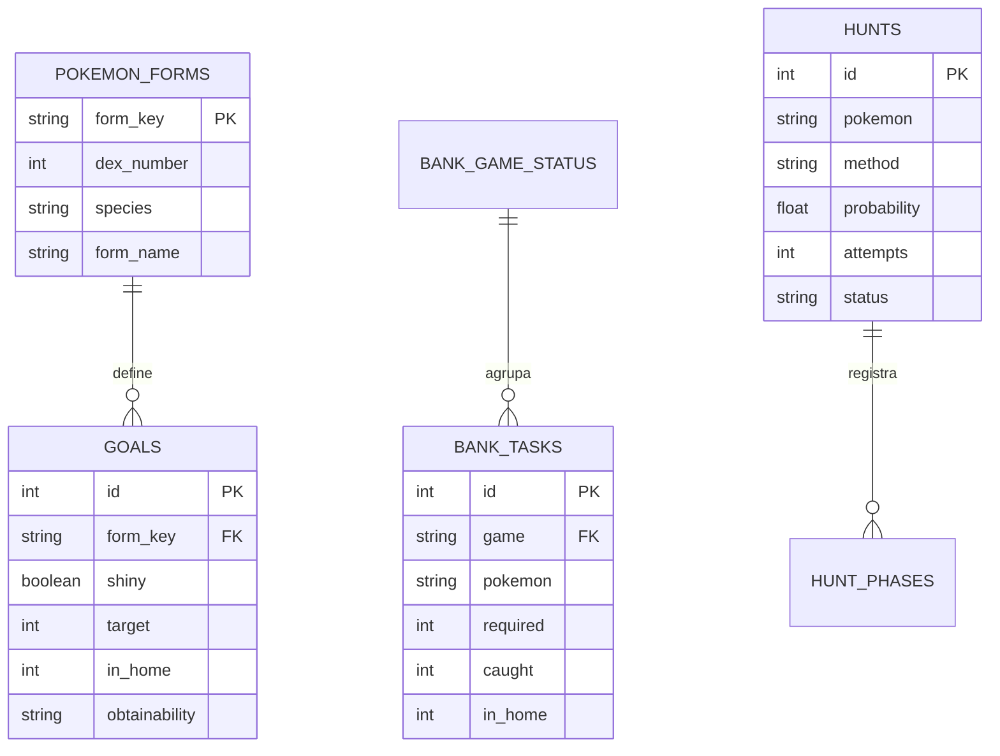

# Arquitectura — Opt. Poke v0.1

## Principios

- **Local primero:** FastAPI y SQLite; no necesita cuentas ni servicios en la nube. Las imágenes se cachean en disco en `~/.optpoke/sprites/`.
- **Datos personales aislados:** SQLite vive en `~/.optpoke`, fuera del repositorio.
- **Catálogo vs. progreso:** la lista de especies/formas es una referencia; los objetivos guardan cantidades y estado.
- **HOME como estado de finalización:** estar capturado no equivale a completar una transferencia de Bank.
- **Importaciones no destructivas:** se evita importar dos veces el mismo archivo mediante hash, y el catálogo se inicializa con `INSERT OR IGNORE`.
- **No inventar datos:** el candado de shiny permanece «sin verificar» hasta tener una verificación fiable; no se muestran tiempos ni métodos no comprobados.

## Diagrama de entidades (simplificado)

## Código

| Directorio | Responsabilidad |
| --- | --- |
| `app/db.py` | Esquema SQLite y catálogo inicial |
| `app/sprite_cache.py` | Descarga autorizada bajo demanda, caché persistente, ausencias y modo offline |
| `app/main.py` | API HTTP, validaciones y persistencia |
| `app/math_utils.py` | Fórmulas de probabilidades |
| `app/xlsx.py` | Lector *solo lectura* de `.xlsx/.xlsm` |
| `app/importers.py` | Migradores originales Bank y ShinyHunts |
| `app/cli.py` | Importación inicial |
| `static/` | UI responsiva (sin compilación de frontend) |
| `data/catalog.json` | Catálogo factual inicial derivado de las dos hojas LITE |
| `tests/` | Pruebas automatizadas |

## Detalles relevantes del catálogo original

- La plantilla actualizada tiene 1.214 entradas shiny y 1.284 normales (incluye Floette Eternal Flower). Las líneas «Gen N» son separadores, no Pokémon.
- En la hoja shiny, **Hoopa Unbound** reutiliza erróneamente la clave `hoopa`. Se reconcilia contra la hoja normal usando número + nombre + forma, y se guarda con `hoopa-1`.
- La fila shiny de **Ursaluna Bloodmoon** no muestra número en `Dex`. La referencia normal permite conservar su n.º 901.
- El archivo combinado antiguo de AustinJohn no refleja el progreso vigente. Ahora se admiten las **dos exportaciones actualizadas y separadas**, cada una con su vista previa y confirmación.
- La forma shiny «bloqueada» no se puede deducir solo de estar en la hoja shiny. Se guarda por ahora `unverified`, editable con candado manual.

## Decisiones futuras

1. Vincular automáticamente cada tarea Bank con `form_key` y con ejemplares concretos.
2. Definir la semántica de `EVO` en las exportaciones de AustinJohn; hasta entonces se informa y omite sin tocar el objetivo.
3. Completar los sprites de formas que no tienen una imagen correcta y, cuando sea necesario, revisar los registros de ausencia guardados.
4. Crear catálogo versionado de juegos, métodos, probabilidades, restricciones de OT y fuentes verificables.
5. Añadir perfiles de partida y condiciones necesarias (Shiny Charm, cadenas, encuentros, etc.).
6. Modelar la probabilidad variable por intento (SOS, cadenas) con modelos independientes.

## Limitaciones conocidas de v0.1

- Bank y Pokédex no se sincronizan aún de manera automática porque no existe correspondencia revisada entre sus registros.
- El comparador está reservado para una versión futura y no calcula el «mejor método» todavía.
- Las imágenes de formas especiales necesitan mapeo exacto; se muestra un marcador para no confundirlas con la forma base.
- El cálculo acumulado actual asume intentos independientes con probabilidad fija.
- Importar una nueva versión **modificada** del Excel Bank no actualiza ni elimina tareas ya importadas; debe hacerse como una migración validada.
- El estado de Shiny Charm se guarda por juego, no por partida todavía.

- Las cuatro fases de Azelf sin número en el Excel se conservan como **fases sin intento conocido**; no se inventa una posición temporal.

## Campo de OT (v0.1.6)

La tabla `goals` incorpora `ot_exception INTEGER NOT NULL DEFAULT 0`. Es un indicador **manual** por objetivo `(form_key, shiny)`, no por especie global. No presupone si el Pokémon está capturado o transferido, ni afecta el estado `obtainability`. Al abrir una base v0.1.5, `initialize()` detecta el esquema previo y migra la columna sin sobrescribir registros. Los respaldos JSON antiguos pueden recuperarse sin esta columna y reciben el valor `0` al importarse.

### Decisiones de presentación

La Shiny Dex y Living Dex usan una superficie continua, sin scroll interno en el índice. La paleta inspira su combinación de grafito/verde en la Pokédex de Teselia de Negro/Blanco; el sitio no incluye archivos de interfaz o tipografías del juego. Las capturas son pruebas de la interfaz con datos ficticios y caché de sprites en modo offline.

## Barra persistente de navegación (v0.1.7)

El grupo `.dex-sticky-header` contiene el encabezado, resumen y filtros de ambas Pokédex. Usa CSS `position: sticky` en el scroll principal del documento, para mantener disponibles búsqueda/ordenación durante el recorrido sin crear un contenedor deslizante independiente. Los cambios de página desplazan las filas hasta debajo de esta barra. La lupa es un SVG inline `aria-hidden`, centrado mediante `top: 50%` y `translateY(-50%)`, por lo que no depende de la línea base de una fuente.

## Panel izquierdo persistente (v0.1.8)

El layout de la Pokédex mantiene la cabecera `dex-sticky-header` fuera de la cuadrícula. Dentro de `pokedex-shell`, la columna `dex-spotlight` se estira para abarcar el índice y su hijo `dex-spotlight-inner` utiliza `position: sticky`. La variable CSS `--dex-header-height` recibe la altura real desde `ResizeObserver` (conexión por vista, desconectada al cambiar de sección). Esto mantiene el panel debajo de la cabecera sin crear un segundo scroll; el índice sigue en el flujo normal del documento. El panel se oculta en anchos <=850 px, donde el índice recibe el ancho completo.

## Importación AustinJohn (v0.1.99)

El módulo `app/austin_import.py` procesa localmente las dos exportaciones XLSX separadas (Shiny y Living), con una previsualización y confirmación por colección.
Solo utiliza las hojas `S-LivingFormLITE` y `LivingFormLITE`, validando forma y
Pokédex nacional (no coordenadas). No ejecuta macros ni fórmulas. Se separan
**previsualización** (sin escrituras) y **aplicación** (transacción SQLite).
La aplicación requiere SHA-256 coincidente para evitar aplicar otro archivo.
El valor `NOT` de la columna de progreso significa **No OT**; activa el indicador
`ot_exception` y nunca modifica `in_home`. La celda 0 aporta al menos una copia,
no implica completar objetivos con `target > 1`. El modo por defecto no borra
progreso previamente marcado; el modo explícito de igualación puede establecer
`in_home = 0` ante una celda 1. Se rechazan hojas sin reconocimientos suficientes
y se muestran advertencias y diferencias antes de cualquier cambio.
