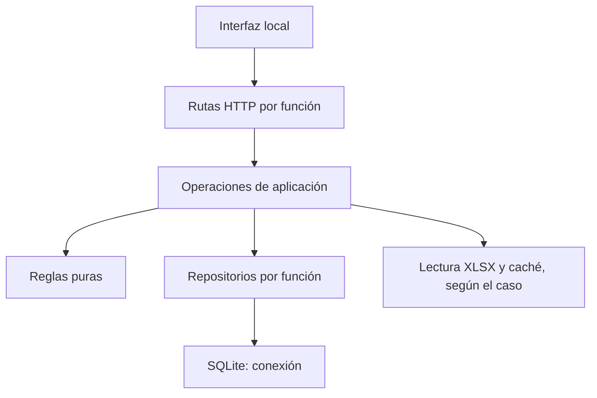
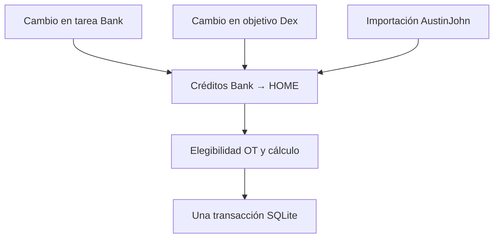

# Arquitectura propuesta — Opt. Poke

**Estado:** propuesta para revisión. Este documento describe la organización que queremos adoptar; [ARQUITECTURA.md](ARQUITECTURA.md) sigue describiendo el código presente en `develop`. Ninguna ruta de este documento implica que el archivo ya exista.

## Decisión principal

Opt. Poke seguirá siendo una sola aplicación local (FastAPI, SQLite y JavaScript servido directamente), organizada por **función del producto**. Dentro de cada función se separarán las rutas HTTP, los casos de uso, las reglas puras y el acceso a datos cuando su tamaño lo justifique. No se crearán capas vacías ni interfaces para un único almacenamiento SQLite.

La ruta completa debe explicar la responsabilidad: `app/bank/home_reconciliation.py` dice más que `app/utils.py`. Archivos como `routes.py` o `repository.py` se admiten dentro de un directorio funcional que les da contexto. `app/main.py` solo inicializará FastAPI, registrará rutas y montará la interfaz; las reglas de dominio vivirán en los módulos de cada función.

## Dependencias



- **Rutas:** reciben solicitudes y traducen validaciones y errores a HTTP; no contienen consultas SQL ni reglas de conciliación.
- **Operaciones de aplicación:** coordinan el caso de uso y una única transacción para todos sus cambios. Pueden llamar reglas y repositorios. Las operaciones que cruzan funciones deben tener un dueño explícito.
- **Reglas puras:** deciden resultados a partir de sus argumentos, sin acceder a FastAPI, SQLite ni la red. Se agrupan por significado (`home_credit.py`, `goal_progress.py`), sin imponer un `rules.py` genérico.
- **Repositorios:** contienen SQL y convierten filas en datos utilizables por los casos de uso. Usan la conexión compartida del caso de uso; no hacen commits propios durante una operación compuesta.
- **Infraestructura:** gestiona apertura/cierre de SQLite, esquema y migraciones; XLSX y fuentes de sprites son límites concretos de entrada/salida.

Las dependencias no vuelven desde repositorios o reglas hacia rutas HTTP. Se evitarán importaciones circulares y accesos directos a tablas de otra función fuera de una operación documentada.

## Árbol objetivo ilustrativo

Crear archivos únicamente al trasladar una responsabilidad existente; los nombres finales podrán ajustarse si reflejan mejor su contenido.

```text
app/
  main.py                         # Iniciar FastAPI y registrar rutas
  dex/
    routes.py                     # API de objetivos y resumen
    goal_progress.py              # Reglas de cantidades, HOME y EVO
    repository.py                 # Consultas de objetivos y catálogo
  bank/
    routes.py                     # API de tareas Bank
    task_service.py               # Alta, edición y eliminación de tareas
    home_reconciliation.py        # Créditos Bank → HOME y su reversión
    link_validation.py            # Validar vínculo de especie, forma y shiny
    repository.py                 # Consultas de tareas y créditos
  games/
    routes.py                     # API de juegos y partidas
    saves_service.py              # Operaciones sobre partidas
    repository.py                 # Persistencia de juegos y partidas
  hunts/
    routes.py                     # API de cacerías y fases
    probability.py                # Cálculos de probabilidad
    repository.py                 # Persistencia de cacerías
  imports/
    routes.py                     # Vista previa y confirmación HTTP
    austin.py                     # Interpretación y aplicación AustinJohn
    legacy.py                     # Importación inicial Bank/cacerías
    xlsx_reader.py                # Lectura segura de planillas conocidas
  backups/
    routes.py                     # Exportación/restauración HTTP
    json_backup.py                # Validación y restauración transaccional
  sprites/
    routes.py                     # API de imágenes y variedades
    cache.py                      # Orígenes permitidos y caché local
  storage/
    connection.py                 # Conexión y transacciones SQLite
    schema.py                     # Esquema para instalaciones nuevas
    migrations.py                 # Actualización de bases existentes
    catalog_seed.py               # Catálogo y bloqueos iniciales
  cli.py
  demo.py
data/                              # Datos factuales versionados
static/                            # Interfaz actual; modularización posterior
tests/                             # Pruebas por comportamiento
```

Este árbol identifica destinos, no exige dividir de inmediato cada archivo pequeño. Las vistas JavaScript se organizarán por función y utilidades compartidas en una etapa propia, sin cambiar la interfaz visual ni añadir compilación por esta decisión. La revisión visual del producto sigue prevista para v0.6.

## Contratos para entender el código

Cada función con nombre que se reorganice llevará una descripción de su contrato **en el mismo cambio**, proporcional a su complejidad: una frase para las simples y más detalle para las que coordinan datos o tienen efectos. Se usarán anotaciones de tipos y docstrings en Python; JSDoc para funciones JavaScript con nombre. Los contratos de rutas públicas, operaciones de aplicación, reglas, repositorios e importadores deben indicar lo que otra parte del proyecto necesita saber:

- **Propósito y entradas:** qué representa cada parámetro cuando el nombre y el tipo no bastan.
- **Resultado y condiciones:** qué devuelve y qué restricciones garantiza (por ejemplo, crédito limitado por objetivo u OT elegible).
- **Efectos:** qué tablas, archivos, cachés o estado de interfaz modifica. En operaciones compuestas, quién abre la transacción y si la función realiza commit.
- **Errores y casos límite:** qué entradas rechaza o qué pasa cuando falta un objetivo, una partida o una fuente de imagen.

Ejemplo de contrato para la operación delicada; el nombre y la firma definitivos se fijarán al extraerla:

```python
def reconcile_bank_home(db, task_id: int, previous_goal_id: int | None = None) -> None:
    """Actualiza el crédito de una tarea y el HOME de los objetivos afectados.

    Usa la transacción abierta por el caso de uso; no hace commit.
    Recalcula el objetivo anterior al cambiar o quitar un vínculo.
    Las transferencias sin vínculo u OT elegible aportan cero.
    No modifica las cantidades capturadas ni transferidas de la tarea.
    """
```

Un comentario dentro de la función explicará **por qué** existe una excepción o compatibilidad histórica; el docstring explicará el contrato. Las funciones auxiliares evidentes pueden tener un contrato de una sola frase; no necesitan párrafos repetitivos. Al revisar cada PR, los contratos deberán coincidir con el comportamiento conservado y con las pruebas de esa operación.

## Operación delicada: Bank → HOME

`app/bank/home_reconciliation.py` será el dueño de la conciliación. La invocarán las operaciones que crean, modifican, desvinculan o eliminan tareas Bank; también las que cambian el OT propio posible o el progreso manual de un objetivo. La importación AustinJohn seguirá pudiendo sobrescribir las filas incluidas y reiniciar los créditos de Bank correspondientes, sin borrar las tareas.



Se conserva la regla actual: solo se acredita una transferencia declarada, vinculada y con OT elegible; el progreso visible se limita al objetivo, sin acreditar tareas anteriores de forma retroactiva. Cambiar una tarea, su vínculo o la disponibilidad de OT recalcula los objetivos afectados. Las reglas de crédito y total deben poder probarse sin HTTP ni SQLite; la operación completa debe probarse con transacciones reales. El importador puede usar una operación explícita para reiniciar créditos, sin crear un segundo cálculo divergente.

## Compatibilidad que debe conservarse

Durante esta reorganización se mantienen las URL, cuerpos y códigos de respuesta de la API, la semántica de HOME/NOT/EVO/OT, el esquema SQLite, el formato JSON de respaldo y el comportamiento de los Excel. Las migraciones deben funcionar sobre bases anteriores sin sobrescribir progreso; los respaldos antiguos deben restaurarse según las reglas actuales. El modo demo debe seguir aislado y el servidor debe funcionar sin conexión salvo las descargas de sprites solicitadas.

## Orden de migración

1. Comprobar los recorridos existentes y sus pruebas de API, Bank → HOME, importación, restauración y migraciones anteriores. Registrar cualquier discrepancia antes de mover código.
2. Extraer conexión, esquema, migraciones y carga inicial desde `db.py`, preservando el orden y resultado de la inicialización.
3. Extraer rutas y acceso a datos de funciones con menos cruces (juegos, cacerías, sprites), sin cambiar las respuestas. Separar después importaciones y respaldos con pruebas de compatibilidad.
4. Extraer Pokédex y Bank, y trasladar la conciliación como una sola operación transaccional. Comprobar cambios de OT, importaciones y correcciones o eliminación de tareas.
5. Revisar la organización JavaScript en una etapa independiente; mantener la revisión visual para v0.6.

Cada etapa irá en una rama y PR propios hacia `develop`, con contratos y pruebas pertinentes y revisión del diff. **El PR quedará abierto para que el propietario decida su integración; no se realizará ningún merge a `develop` desde este trabajo.** Hasta que una etapa se integre, los documentos de arquitectura actual y propuesta se mantendrán separados.
